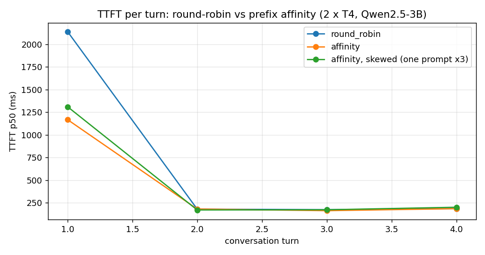

# prefixrouter

Prefix-aware routing gateway for LLM replicas: requests sharing a system prompt land on the same replica so KV cache blocks get reused.

Project 4 of 15 in [inference-infra-portfolio](https://github.com/NomanJafar/inference-infra-portfolio).

## What this builds

A gateway that routes requests sharing a system prompt to the same replica so cached KV blocks are reused instead of recomputed.

## Why it matters

Reused cache is free speed: up to 80% TTFT cuts on multi-turn workloads.

## Status

Done. 2xT4 results below; raw data in [`results/kaggle_run3/`](results/kaggle_run3/) (runs 1–2 failed on a one-GPU spawn bug and on `asyncio.run` inside Jupyter; post-mortems in `results/kaggle_run1..2/`).

## What is in here

| Module | Purpose |
|---|---|
| `prefixrouter.ring` | Affinity key (hash of the system prompt, or of the first user message's leading chars) and a consistent-hash ring with virtual nodes |
| `prefixrouter.router` | The decision: affinity replica unless it is above the load threshold, then least-loaded; round-robin mode as the baseline; decision counters |
| `prefixrouter.proxy` | OpenAI-compatible gateway: streaming passthrough, `x-prefixrouter-replica` / `x-prefixrouter-reason` on every response, `/metrics` with decisions, per-replica load and each replica's prefix-cache hit rate scraped from vLLM |
| `prefixrouter.load` | Multi-turn session load: K system prompts x S sessions x T turns, sessions concurrent, turns sequential, every record tagged with the replica that served it |
| `notebooks/kaggle_prefixrouter.ipynb` | Two vLLM replicas (Qwen2.5-3B-Instruct, one per T4, prefix caching on) behind the gateway; round-robin vs affinity vs skewed affinity, replicas restarted cold before each |

22 tests, the proxy exercised end to end against two live [tokenbench](https://github.com/NomanJafar/tokenbench) mock replicas.

## Results (2 x Tesla T4, vLLM 0.31.0, Qwen2.5-3B-Instruct FP16, Kaggle, 2026-10-15)

Load per condition: 4 distinct ~1,200-token system prompts, 4 sessions each, 4 turns per session (64 requests), 48 output tokens per turn; the skewed condition uses one prompt for 3 of the 4 session groups. Replicas were restarted (cold caches) before each condition; the engines were warmed with a neutral prompt first.

| condition | requests | errors | ttft_p50_ms | ttft_p95_ms | turn0_ttft_p50_ms | turn1_ttft_p50_ms | turn2_ttft_p50_ms | turn3_ttft_p50_ms | hit_rate_r1 | hit_rate_r2 | split | decisions |
|---|---|---|---|---|---|---|---|---|---|---|---|---|
| round_robin | 64 | 0 | 203 | 2198 | 2139 | 181 | 175 | 187 | 0.87 | 0.87 | 32/32 | {"round_robin": 64} |
| affinity | 64 | 0 | 189 | 1318 | 1168 | 182 | 164 | 187 | 0.94 | 0.93 | 32/32 | {"affinity": 48, "fallback": 16} |
| affinity, skewed (one prompt x3) | 64 | 0 | 199 | 1317 | 1310 | 172 | 174 | 202 | 0.92 | 0.95 | 24/40 | {"fallback": 24, "affinity": 40} |

`turnN_ttft_p50_ms` is the median TTFT of all requests at that turn; `hit_rate_rN` is each replica's prefix-cache token hit rate over the condition (from vLLM's own counters); `split` is requests per replica.



### What the numbers say

1. **Affinity halves the cold-start cost.** At turn 0 every session's 1,200-token system prompt is new to the system. Round-robin spread each prompt over *both* replicas, so each replica prefilled all four prompts: TTFT p50 2,139 ms, p95 2,198 ms. Affinity sent each prompt to one replica, where the first session paid the prefill and the other three hit the cache: **1,168 ms p50 (−45%), 1,318 ms p95 (−40%)**, and the hit rate rose from 0.87 to 0.94 on both replicas.
2. **After turn 0 there is nothing left to win in this setup.** Turns 1–3 cost ~180 ms in all three conditions. With four prompts and two replicas, round-robin has warmed both caches by the end of turn 0 (the whole working set fits in each replica's 187k-token cache many times over), and a turn's new tokens (~70) are cheap to prefill anywhere. The "up to 80% TTFT reduction" claim for prefix-aware routing describes the case where the working set does *not* fit in every replica, or caches churn (restarts, autoscaling, many tenants); this toy is too small to show it, and the README says so rather than pretending.
3. **The valve works.** With one prompt carrying three quarters of the sessions, pure affinity would have put 48 of 64 requests on one replica. The load threshold diverted 24 requests (`fallback`), the split became 24/40, and TTFT stayed level with the balanced case (199 vs 189 ms p50; turn-0 p95 identical at 1,317 ms). The cost of a fallback, one extra prefill of the dominant prompt on the other replica, was paid once and then cached (hit rates 0.92 / 0.95).
4. **Routing is free at this scale.** Median ITL was 38.7–41.2 ms in every condition, the same as the replicas serve directly; the proxy adds no measurable per-token overhead.

### What was not measured

Many more system prompts than fit in a replica's cache (the regime where affinity should matter for every turn); replica churn; a request mix with no system prompt (the first-user-message key); more than two replicas; tail latency with enough samples (64 requests per condition is few, and the p95 column is driven by the simultaneous cold start).

## Layout

```
CONCEPTS.md     the theory behind the project, written before the code
src/prefixrouter/   implementation
tests/          CPU-only tests, runnable on a laptop
notebooks/      GPU notebooks (Kaggle / Colab) that run the experiments and write results/
results/        measured numbers and plots
```

## Running

```bash
python -m venv .venv && source .venv/bin/activate
pip install -e ".[dev]"
pytest
```

GPU experiments run from `notebooks/`; each notebook clones this repo, installs it and writes its outputs to `results/`.

## Hardware notes

Developed against free-tier GPUs (Kaggle and Colab T4, 16 GB). Where a T4 limits what can be measured (no FP8, Turing-era kernels), the README says so rather than papering over it.

## License

MIT
